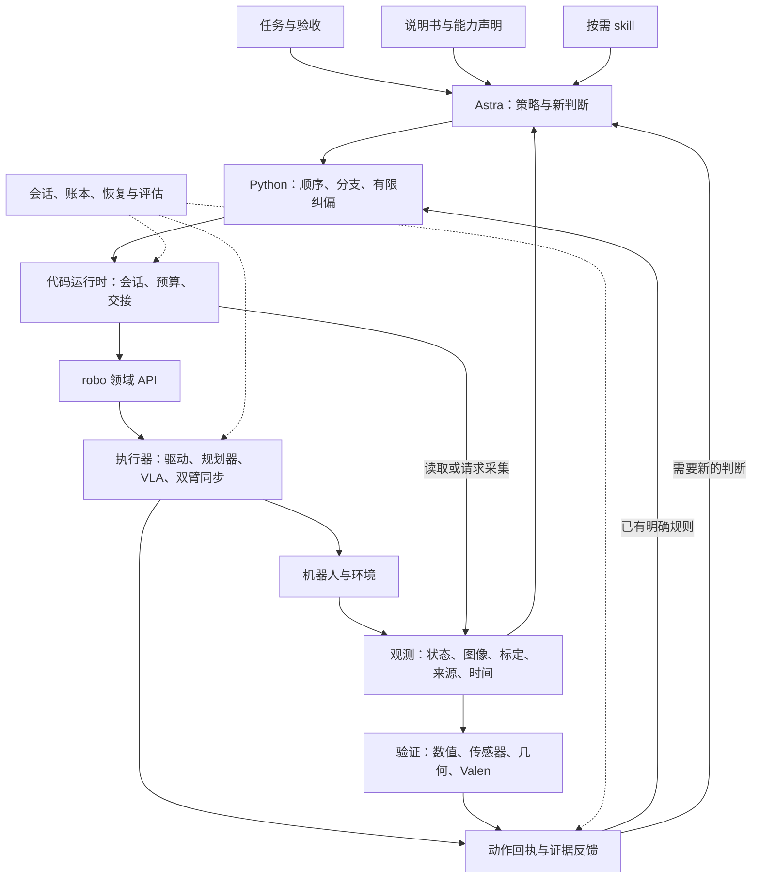

# 整体架构与公共契约

[设计索引](index.md) · [推进顺序](roadmap.md)

## 状态与范围

本设计基于 2026-10-31 UTC 当前工作区的静态梳理，包含未提交实现。
下文分别说明已有流程和目标契约；拟议数据对象及状态规则尚未统一实现。
本文定义跨模块关系，各 part 的职责、输入输出、失败交接与源码依据见 [模块索引](index.md)。
2026-11-01 已落实来源身份、精确动作回执、独立 verify 和 unknown 对账的首条闭环；
具体字段、后端限制与测试入口见 [实施记录](interaction-contracts.md)。其余公共对象仍是目标设计。

核心分工是：**Astra 决定任务策略，Python 表达策略，执行器落实动作，观测与验证提供证据，框架管理交接。**
抓取、交接、搬运等任务顺序由模型结合现场生成。领域 API 保留 `robo.move_to`、`robo.move_both`
等明确操作，能力内部可以使用驱动、规划器或 VLA policy。

## 当前主流程与模式边界

当前在线入口的大致关系如下；实际文件可能同时承担多个逻辑职责：

```text
play_episode → host.boot / dump_card → RobotAdapter / robo
             → build_prompt → agent runtime
             → ArmToolkit.python → RobotBase → Backend / host → 环境
             ← 代码结果、动作记录、状态、图像、监督与恢复反馈
```

主要实现位于 `src/pyrualean/play.py::play_episode/build_prompt`、
`src/pyrualean/arms.py::ArmToolkit`、`src/pyrualean/_robot.py::RobotBase`、
`src/pyrualean/_backend.py::Backend` 及各 `hosts/` 实现。

| 运行模式 | 当前会话与模型行为 | 设计约束 |
| --- | --- | --- |
| 在线 `cells` | Python namespace 跨 cell 保留；模型收到结果后生成后续代码 | 当前监督与 stuck 恢复主要适用于此模式；保留变量不等于变量依据仍有效 |
| 在线 `program` | 每次程序使用新的 namespace；可配置程序尝试次数 | 单次额度不产生第二次修复机会；当前不能启用同一套 cells 监督/stuck 配置 |
| `generate` 后离线运行、RSI 固定程序 | 执行时没有在线模型决策 | 只执行程序已有的分支和恢复逻辑，不默默增加模型调用 |

CLI 的 cells 默认配置与 Python API、XPolicyLab 部署配置不同，应按各自配置判断能力是否启用。
代码中的 `arm=cells/program` 表示执行/实验模式，机械臂的 left/right 是另一层含义。

## 目标关系与三个闭环

下图表示目标分工；独立观测到验证、完整动作回执和停止确认等连接仍需补齐。



| 层次 | 决策内容 | 交回条件 | 保证的负责方 |
| --- | --- | --- | --- |
| 程序内闭环 | 已明确条件的分支、有限纠偏与局部验证 | 未知证据、次数耗尽、无进展或未处理错误 | 程序表达规则，运行时落实可强制执行的边界 |
| 模型闭环 | 目标选择、双臂角色、方法切换、后续代码 | 下一段程序或明确终止/恢复意图 | Astra；框架提供完整现场和约束 |
| 底层控制闭环 | 轨迹跟踪、保持、约束检查、停止 | 端点、检查点、故障或停止回执 | 具体 host/设备控制器；必须声明实际保证 |

等待 Astra 或 Valen 时，设备的保持、受控停止及监控责任仍需由执行控制层定义。
当前仿真原语循环和双臂同步实现不能直接当作完整真机持续控制保证。

## 交互响应目标

框架还需控制“反馈就绪到下一段完整代码可执行”的等待。用户反馈与已有局部日志都指向 Astra 出码前的延迟；
底层控制持续工作不能保证模型层交互及时。现有样本的代码已经较短，不能预设长程序是主要原因。

模型接入、上下文、运行时和记录模块共同维护 decision/attempt/tool 身份与时间点，
区分请求、首事件、完整工具参数、代码校验、执行和反馈。每次判断的 deadline 计入 episode 预算；
上下文变化的候选重新校验依赖；deadline 到期、已取消或被替代的 attempt 失去原派发许可，
后续采用其代码也须建立新的决策与准入记录。
短 cell、本地规则与推理投入需要以延迟和任务质量的对照结果选择；流式派发保留完整代码边界。
现状、拟议协议及实验顺序见 [交互延迟设计](interaction-latency.md)。

## 职责边界

| 信息或行为 | 主要负责人 | 其他模块的职责 |
| --- | --- | --- |
| 任务要求与权威验收 | 任务与会话 | 模型派生条件须标为解释/假设，评估保留判定来源 |
| 目标、动作次序与局部策略 | Astra 与生成程序 | skill 提供经验，执行器检查能力与执行约束 |
| 观测身份、时间和对齐 | 观测/host 采集端 | 运行时转发，验证不重新制造采集身份 |
| 动作状态与停止确认 | 执行器/适配器 | 运行时维护关联，恢复先对账再放行依赖动作 |
| 原子事实判断 | 验证器 | Valen、几何或传感器各自说明来源与限制 |
| 事实有效性和已声明前置条件 | 证据与监督 | 模型声明任务依赖，host 落实已注册门控 |
| 全局预算、会话准入与交接 | 会话/代码运行时 | 控制器落实局部执行限额，所有消耗进入统一快照 |
| 记录与评分 | 记录评估 | 不把评分规则改写成底层观测事实 |

## 公共数据契约 {#shared-contracts}

以下是待补齐的最小语义，不是当前可导入类型或已确定的序列化 schema。
实现前需冻结字段类型、必选性、版本规则和适配器能力声明；优先在内部贯通，再决定是否增加公开参数。

| 契约 | 主要生产方 → 使用方 | 最小内容 | 当前基础与缺口 |
| --- | --- | --- | --- |
| `TaskSpec` | 任务入口 → Astra、会话、评估 | 指令及来源、约束、验收条件及来源、假设、资源、判定方 | `TaskCard` 已有；结构化验收/假设待补 |
| `CapabilityManifest` | 适配器 → prompt、程序、执行器 | 设备/host/接口版本、坐标单位、标定引用、能力、副作用、保证范围 | 注册表、API reference、双臂能力已有；统一声明待补 |
| `ObservationSnapshot` | 采集端 → 感知、验证、Astra | episode/观测/源帧身份、状态与图像、标定、各类时间、对齐与缺失信息 | 图像/状态记录与反馈 envelope 已有；端到端源身份与一致快照待补 |
| `ActionReceipt` | 执行器 → 程序、恢复、记录 | 动作身份、依据观测、接收/派发/执行状态、实际效果、确定性、预算、取消与停止状态 | 调用账本、类型化结果、双臂 partial 已有；跨端因果关联与对账待补 |
| `EvidenceRecord` | 验证器/账本 → 程序、门控、Astra | 事实/问题版本、对象、判断、验证器、源观测、有效范围、失效原因 | `EvidenceLedger` 已有；源时效与多验证器约定待补 |
| `BudgetSnapshot` | 会话/执行记账 → 所有决策方 | 额度单位、作用域、已消耗、已预留、剩余量、截止时刻/时钟 | 现有各级预算分散；统一快照与计量待补 |
| `DecisionContext` | 上下文组装 → Astra | 任务/能力版本、有效证据、进展、未决动作、预算、触发原因 | prompt 与工具反馈已有；统一决策快照待补 |
| `HandoffReport` | 运行时/恢复 → Astra、会话 | 代码状态、交接原因、已发生效果、未知结果、现场引用、预算、允许的后续操作 | `failure/recovery` 已有；统一状态与恢复准入待补 |

共同标识建议包括 `schema_version`、session/episode 标识、代码调用 ID、动作 ID 和观测 ID。
跨重置须使用新的 episode 身份；回包迟到不能被归入下一次调用。标识生成方和校验方须在适配器契约中明确。

### 观测身份与时效

1. 源帧身份由采集端提供；重读、裁剪或重新提问保持与原观测的关联。
2. 分开 `captured_at`、`received_at`、`retrieved_at`，注明时钟来源；未知时间保持未知。
3. 原生控制步数、录制索引、动作 revision 和传感器帧编号是不同量，不能互换。
4. 多相机/状态无法原子采集时，显式报告时间差和对齐限制；感知及验证校验自己的容忍范围。
5. 新请求不代表新帧，新帧也不自动构成统计独立样本；重复确认策略须明确去重与采样要求。

### 动作状态与结果确定性

分别记录请求接收/派发、执行进展、实际效果、目标是否达到、结果确定性及停止确认。
“已派发但结果未知”“确定部分执行”“执行结束但未到位”需要不同处理，不能统一为一个失败布尔。

取消请求只是请求；停止确认需要来自执行端的证据。未确认期间，执行层保留对账和状态读取能力，
阻断依赖该动作结果的新动作。超时后不自动重放：先查询原动作，再核对现场；缺少查询能力的适配器
应报告无法确定，维持受限状态，必要时交接操作者，不能假定超时表示未执行。
动作 ID 可支持重复请求检测，但具体去重保证须由后端声明，不能据此承诺物理动作恰好执行一次。

### 预算与副作用

预算至少区分 episode 时间、代码调用数、代码时间、原语尝试数、原生控制步、观测/验证成本和输出量。
预留量与确认消耗分开。局部额度可在新调用建立，全局额度不因修复、重试或 skill 加载重置。
目前 `move_both` 的每个执行检查点会经过 `_stateful`；不能将现有 action 计数直接当成高层运动调用数。

能力副作用应区分历史读取、采集、推理、规划、驱动动作和停止控制。
只读验证允许必要的审计写入，但不能通过 callback 隐式驱动机器人。
如果新观测需要移动相机或推进仿真，适配器必须说明副作用和消耗，并按对应能力执行。

## 失败与控制权交接

| 现场情况 | 接管方 | 继续条件 |
| --- | --- | --- |
| 校验失败，确定没有执行该代码 | Astra | 修正代码/参数后重新校验 |
| 确定的可恢复偏差且程序有规则 | 当前程序 | 证据有效、预算允许、局部次数受限 |
| 观测缺失/过期或验证不确定 | 观测/验证；需要新策略时 Astra | 获得可用于该条件的证据，或修改后续策略 |
| 部分执行且终点确定 | 程序或 Astra | 从实际终点与物体状态生成剩余工作 |
| 结果未知或停止未确认 | 执行系统先接管 | 完成回执/现场核对，明确可继续的动作范围 |
| 未处理错误、无进展、确认 stuck | Astra | 读取交接报告；按配置加载恢复知识，保留原预算 |
| 会话终止或全局预算耗尽 | 会话与执行系统 | 关闭新动作准入，处理停止与审计，不重新开放 episode |

暂停后的“继续”是从实际现场生成新的代码，当前没有恢复旧 Python 调用栈或自动回滚的语义。
namespace 可能部分改变，中断赋值的目标变量可能仍保存上个 cell 的值。
目标设计应明确暂停时哪些动作仍在途、谁继续监控，以及何时允许再次执行代码。

## 完成判定与可审查性

分别保留以下结论及来源：

- 代码执行结束：本段程序返回或被中断。
- 动作执行结束：执行端报告动作生命周期状态。
- 局部条件通过：指定验证器在指定观测上支持某个条件。
- Astra 声明完成：模型给出的任务结论。
- 权威任务判定：benchmark 或任务指定判定方给出的结果。

当前 `play.py` 已分开保存模型 `finish` 和 `environment_success`，应保留这一点。
RoboDojo 不提供与其他适配器相同的在线 `done`；不能为了统一类型而向模型制造实时成功信号。
benchmark 可以把缺失结果按失败计分，但底层记录仍应保留未知/错误及其原因。

目标审计链是：**任务与决策上下文 → 代码 → 动作 → 回执/观测 → 验证事实 → 放行或交接 → 判定**。
实现与验收顺序见 [推进路线](roadmap.md)，各节点的实际代码基础见 [模块设计](index.md)。
