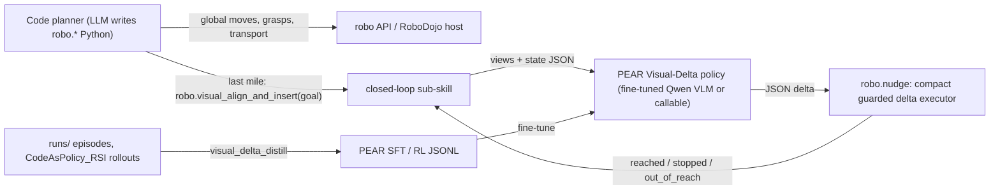

# Hierarchical Code + PEAR Visual-Delta

CodeAsPolicy is good at global reasoning: finding and remembering objects, staged grasps,
collision-free transport. It is weak in the last 5 cm, where open-loop triangulation leaves
3-8 mm residuals and contact tasks (`insert_key`, `plug_in_charger`, `hang_mugs`,
`press_by_number`, `pour_liquid_into_cup`) fail. The hierarchy splits the work:



| Layer | Module | Owner |
| --- | --- | --- |
| Protocol parser, prompts, policy client | `src/codeaspolicy/visual_delta.py` | delta-skill |
| `nudge`, `visual_align_and_insert` on RoboDojo | `src/codeaspolicy/hosts/robodojo_visual_delta.py` | delta-skill |
| Distillation + live recording | `src/codeaspolicy/visual_delta_distill.py` | rsi-distill |

## PEAR Visual-Delta protocol v1

Each turn the policy sees a **state JSON** and labelled images, and answers with optional
`<think>...</think>` and one fenced `json` block.

```json
{"arm": {"x": 0.4, "y": -0.2, "z": -1.0, "roll": 0, "pitch": 0, "yaw": 0.05}, "gripper": {"width": 0}}
```

Bimanual mode uses `left_arm`, `right_arm`, `left_gripper` and `right_gripper` as keys. A
top-level `"done": true` ends the sub-skill.

| Field | Unit | Convention |
| --- | --- | --- |
| `x, y, z` | cm | TCP grasp point (link6 + `TCP_OFFSET` = 0.145 m along link6 +x), `next - current`. `frame="world"`: +x robot's right, +y away from the robot, +z up. `frame="tcp"`: the world delta in current link6 axes (+x pointing, +y finger closing, +z normal). |
| `roll, pitch, yaw` (world) | rad | Wrapped difference of `robodojo_kinematics.angles()` (pitch, yaw, roll in degrees), folded near vertical (below). Executor: `target = current + delta` through `kin.orientation(pitch, yaw, roll)`. |
| `roll, pitch, yaw` (tcp) | rad | The relative rotation `R0^T R1 = Rz(yaw) Ry(pitch) Rx(roll)` about the current gripper axes. Executor: `R0 Rz(dyaw) Ry(dpitch) Rx(droll)`. |
| action `gripper.width` | switch | `+1` open, `-1` close, `0` keep. RoboDojo: `OPEN=-1`, `CLOSE=1`; `ee_joint_state` command `1.0` open, `0.0` closed. A command `<= 0.05` counts as closed (the host's threshold). |
| state `gripper.width` | cm | Jaw span `round((0.0023 + 0.1091 * opening) * 100, 1)`. |
| state `x, y, z` / angles | cm / rad | Rounded to 1 / 2 decimals. |

> [!IMPORTANT]
> The sign of the gripper switch is opposite to RoboDojo's internal code. Always convert
> through `pear_gripper_to_robodojo()` / `robodojo_gripper_to_pear()` /
> `ee_command_to_pear()` (exported by both modules), never by hand.

## Online layer: `robo.nudge` and `robo.visual_align_and_insert`

- `robo.nudge(arm, x=..., z=..., frame="world"|"tcp", stop_on_stall=True)` moves by a bounded
  relative delta (default at most 6 cm and 20 degrees). Compact mode steps straight along IK
  waypoints with no rest-to-rest spline, so a 1 cm move costs a few native steps. Contact or
  stall ends it cleanly with `status="stopped"`, `stalled=True`,
  `stop_reason="contact_or_stall"`. A table-colliding or unreachable target uses 0 steps.
- `robo.visual_align_and_insert(goal, arm="right", frame="world", max_rounds=8,
  max_steps=40, reserve_steps=20, crop_wrist=True, policy=None)` runs the closed loop: capture
  views and state, ask the policy, run the delta through `nudge`, and report the outcome in the
  next turn. It stops on `done`, convergence, a completed contact, or the budget.
- The policy is an OpenAI-compatible server (`CODEASPOLICY_DELTA_BASE_URL`,
  `CODEASPOLICY_DELTA_MODEL`, `CODEASPOLICY_DELTA_API_KEY_ENV` / `OPENAI_API_KEY`). A Python
  callable can stand in for tests and local policies.

Typical planner use: transport the key to about 2 cm above the lock with ordinary motion,
then `robo.visual_align_and_insert("insert the key into the lock slot", arm="right")`.

## Offline layer: distilling training data

`visual_delta_distill` turns recorded episodes into **one sample per turn**, rendered exactly
like the requests `visual_align_and_insert` sends. Training and serving see the same text:

- **system**: `visual_delta.SYSTEM_PROMPT`. It is imported when that module is present, and
  otherwise a verbatim copy is used; a test checks that the two are identical.
- **user**: the views first, as `[label]<image>` each, then `visual_delta.build_user_prompt(...)`
  (goal, arm mode, frame, round, steps left, the per-move limits actually used for
  coalescing, image labels, state JSON, and the last execution). The last execution follows the
  `format_feedback` shape: `{"status", "reason", "steps_used", "achieved", ["stalled"], "holding"}`.
- **views**: `cam_head` plus the active wrist for one arm, all three cameras for both arms. Each
  wrist is followed by `<wrist>_crop`, the centre 50% upsampled to full size (bicubic, as
  `crop_center` does). Use `--no-crop` to leave the crops out. The record's `images` list holds
  the paths in placeholder order.
- **assistant**: a templated `<think>` rationale and the reference action JSON. Segments that end
  a successful episode get a final zero-delta `"done": true` turn.
- **history**: none by default (`history_turns=0` online). `--history-turns N` (or `-1` for all)
  adds the previous text-only user/assistant pairs, as `OpenAIVisualDeltaClient(history_turns=N)`
  does.

`--format rl` emits `prompt` (all messages except the reply), `images`, `solution` (the action)
and `reference` instead of `messages`.

### Macro-step coalescing

Native steps are far too fine for a VLM turn. `coalesce()` merges consecutive recorded states
into PEAR "move until at rest" deltas. A macro step closes:

- at a contact or stall stop (the next turn then reports `stopped`);
- at a gripper command change, so each turn has at most one switch;
- before a phase change (`call.kwargs.phase`, else the tool name);
- before it would exceed `max_linear_m` / `max_angular_deg`. The defaults are 3 cm and 15
  degrees, `visual_align_and_insert`'s per-round limits; a free `nudge` allows 6 cm and 20
  degrees. The caps are written into each prompt's limits line, so every label is one
  executable move.

Steps with no motion (under 1 mm and 0.5 degrees), no switch and no stop are dropped as hold
noise. Linear motion is measured as TCP distance. Rotation is the larger of the geodesic angle
and the largest single angle of the delta, because `nudge` checks its limit per angle.

A recorded transition can already be larger than one `nudge` (for example 8 cm, or a 90 degree
wrist spin, between two snapshots). Such a step is flagged `oversize`, and
`--oversize drop|split|keep` controls what happens to it:

- `drop` (the default): the run of turns ends before the step and a new run starts after it.
  The counts appear as `oversize_dropped` in records and in `stats`.
- `split`: the step becomes N equal sub-deltas within the caps. Each part shows the start
  frame's images with its interpolated state, and the gripper switch and stop go on the last
  part.
- `keep`: the step is flagged and left in its run.

### Near-vertical angles

When the gripper points nearly straight down (or up), yaw and roll turn about almost the same
axis, and `angles()` can trade about 90 degrees between them for a tilt of under 1 degree. Above
`NEAR_VERTICAL_DEG` = 85 degrees, both modules use the same convention: only
`yaw - sign(pitch) * roll` is well defined. State JSON reports `canonical_angles()` (that value
as yaw, roll 0). When both poses are beyond the threshold, a delta is
`dyaw = wrap((y1 - s1*r1) - (y0 - s0*r0))` with `droll = 0`, which an executor applies as a turn
about world z.

### Episode directories

`load_episode()` reads `result.json` (`environment_success`, `env_steps`), `card.json`
(`task_language`), `calls.jsonl` (tool, kwargs, summary, `env_steps`, `action_id`) and
`steps/NNNN/observation.json` with the camera PNGs. Each recorded state is attached to the call
that produced it, by `action_id` or else by cumulative native steps. That call supplies the
phase, the stop (`summary.stalled` / `status == "stopped"` / `stop_reason`) and the gripper
command. Poses come from `<arm>_ee_pose`, or from forward kinematics of the joints when numpy
is available.

```bash
# full episodes, one SFT sample per turn
python -m codeaspolicy.visual_delta_distill extract runs/ -o data/sft.jsonl --success-only

# last-mile contact segments only, RL prompt / solution samples, tcp-frame labels
python -m codeaspolicy.visual_delta_distill extract runs/ -o data/rl.jsonl \
    --last-mile --format rl --frame tcp

# macro chunks vs native steps, delta distributions, contact-stop ratio
python -m codeaspolicy.visual_delta_distill stats data/sft.jsonl
python -m codeaspolicy.visual_delta_distill stats runs/
```

`--last-mile` keeps runs of transitions in `CONTACT_PHASES` (`align`, `contact`, `nudge`,
`visual_align_and_insert`, `grasp_step`, `probe`, `insert`, `press`, `close`,
`close_gripper`, or a custom `--phases` list). `--radius-m R` keeps transitions that end within
R of the target, which is the episode's final TCP position unless one is given.

### Live recording in CodeAsPolicy_RSI rollouts

```python
from codeaspolicy.visual_delta_distill import ExtractOptions, VisualDeltaEnvRecorder

env = VisualDeltaEnvRecorder(env, "runs/visual_delta", task=instruction,
                             options=ExtractOptions(last_mile=True))
with env.phase("insert"):
    ...                       # env.step / env.get_obs as usual
env.mark_stop()               # when an executor detects contact or a stall
env.on_trial_end({"environment_success": solved})   # appends to visual_delta.jsonl
```

The wrapper delegates everything else to the env. It records one frame per observation read
after an action, with gripper levels taken from `<arm>_ee_joint_state` in the actions, and
writes `trial_NNNN/steps/NNNN/observation.json` plus PNGs. That lets `extract` re-process the
trials later with other options.

## Training recipe (suggested)

1. Collect successful `CodeAsPolicy_RSI` rollouts with the recorder, together with the offline
   `runs/`.
2. SFT a small Qwen-VL model on `--last-mile` samples. The `<image>` placeholders and the
   `images` list match the LLaMA-Factory and ms-swift multimodal formats.
3. RL with `--format rl` samples. Reward from JSON validity, sign agreement and distance to
   `solution`, then from in-simulator success through `visual_align_and_insert`.
4. Serve it behind an OpenAI-compatible endpoint and point `CODEASPOLICY_DELTA_BASE_URL` at it.

Tests: `tests/test_visual_delta_distill.py`. They are pure Python, and the check against host
kinematics runs when numpy is present.
