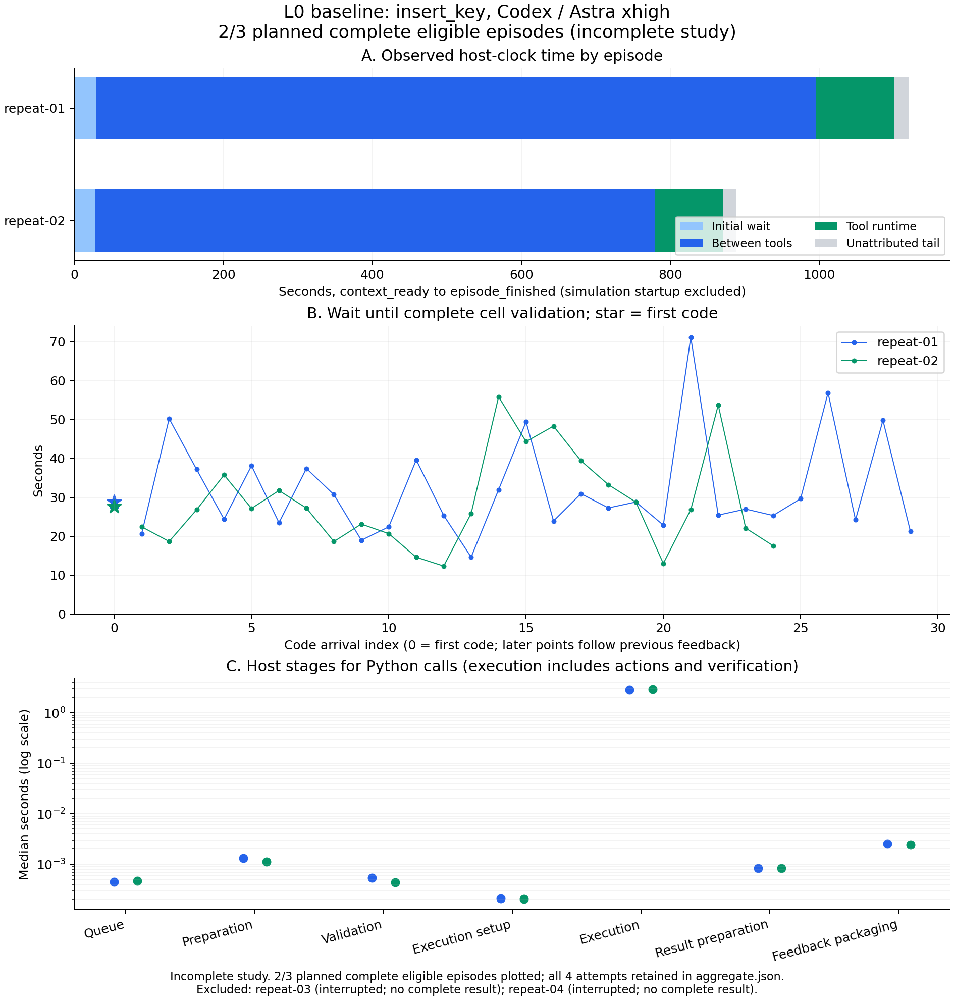

# L0：insert_key 固定任务重复基线

[推进路线](roadmap.md) · [交互延迟设计](interaction-latency.md)

日期：2026-11-01（Asia/Singapore）。本实验用于定位 Astra 出码前的等待，并决定 L1 首个单因素对照。
原计划固定配置采集三次完整 episode；实际保留 **2 次完整运行与 2 次采集中断**，未收齐计划样本。
完整运行中约 **88.4%** 的 host 观测窗口发生在调用到达前，续轮代码等待中位 **26.98 s**，
cell 执行中位 **2.89 s**。L1 首个候选为 `xhigh → high` 单因素对照；尚未运行对照或改变默认值。
采样中未调整 reasoning、prompt 或工具策略，结论限于本路径及这些轨迹。

## 固定条件与采样规则

| 项目 | 固定条件 |
| --- | --- |
| 任务与现场 | RoboDojo `insert_key`、`arx_x5`、`robodojo_xpl_rgb`；layout 索引 0、布局集 `eval_seed=0` |
| 模型接入 | Codex CLI 0.162.1；`gpt-6-astra`；显式 `xhigh`，保留当前 CLI 的推理档位 |
| 执行与反馈 | `cells`、`no-vla`、`on-motion`、`rich`；当前标准入口，无历史任务 recipe 注入 |
| 监督与恢复 | 本地 Valen-4B，pause；阈值 0.8、请求上限 30 s、连续 unknown 上限 2、每 cell 监督动作上限 8；stuck 恢复上限 2 轮 |
| 预算 | 每 episode policy 1,200 s；每 cell 120 s；不设 max_turns 或独立 code_max_actions；任务原生步数上限 300，与 CLI max_episode_steps=10,000 分开 |
| 隔离 | 各次串行；每次新仿真、Python namespace、输出目录与无历史会话的 CODEX_HOME |
| 硬件 | 仿真/SAM3 用 GPU3，Valen 用 GPU0；Valen 服务一次加载供全部尝试使用 |

layout/布局集固定不保证物理仿真、渲染或模型生成完全确定。比较初始图像和状态哈希，
记录模型自然产生的不同策略、监督检查、恢复与实际轨迹。
独立 CODEX_HOME 不等于供应端冷缓存；保留实际 input/cached/output/reasoning token 和运行顺序，
不将第一轮直接命名为冷缓存，也不把第二轮直接命名为热缓存。

计划数量指完整 episode，不要求三个成功结果；失败、超时、内部请求重试和客户端尝试均保留。
首次基础设施失败会停止盲目重复，修复与补跑另编号，不覆盖失败产物。
启动仿真不计入 1,200 s policy 预算，分别报告 startup、policy 和 total。
cell execution 包括同步动作、图像读取与核验等待，不等于 Python CPU 时间。

实验输入先写入 `runs/l0-insert-key-codex-xhigh-20261101/manifest.json`，
源码快照、二进制/权重指纹、完整启动参数与服务健康回执保存在同一目录。
历史 skill-run 的额外提示文本、high/on-demand/pure 配置不与本组样本合并。

### 采样偏离：保留中断并另编号补采

原计划为 `repeat-01/02/03`。前两次正常结束后，主采集进程返回退出码 143；
第三次策略进程退出，未生成 `result.json`，最后保留 6 次工具反馈。
宿主核查确认 Valen 仍健康，仿真残留另经身份核验后清理。终止来源无法确定，
不将其归因于 Astra、机器人失败或 policy 超时。

第三次的原始文件全部保留，标为 **采集中断**，不进入完整 episode 的合并统计。
以原冻结配置另编号 `repeat-04` 补采；只改变会话与输出目录。
原始 manifest 不改写，偏离原因、进程核查、清理和补采启动分别保存在
`sampling-deviation.json`、`service/` 与 `progress.json`。正式报告同时列出完整与中断尝试，
不隐藏基础设施失败，也不把中断当作原生任务失败。

补采 `repeat-04` 随后也在会话中断后退出，最后保留 23 次反馈，没有终局结果；
资源采样器于 03:35:20 UTC 记录 driver 已退出。此次不再连续补跑，
以 `collection-closeout.json` 记录 **计划 3 次、实际完整 2 次、部分 2 次**。
两次中断的完整耗时与任务结果均未知，不能当作 timeout、成功或失败填入分母。

## 测量与解释边界

| 区间 | 本轮含义 |
| --- | --- |
| context_ready → 首个 tool_received / code_validated | 初轮上下文就绪后的完整工具/校验等待，包含启动客户端与接入开销 |
| feedback_ready → 下个 tool_received | 续轮等待：客户端、网络、供应端、重试、压缩及无代码回复可能共同贡献 |
| tool_received → tool_started | host 排队 |
| tool_started → validation_started | tool/cell 准备，包括源码落盘、审计与执行前快照 |
| validation_started → code_validated | sandbox 拒绝检查及完整 cell 编译；不是完整动作准入证明 |
| code_validated → execution_started | 执行设置 |
| execution_started → execution_finished | cell 执行，含同步动作与核验 |
| execution_finished → tool_result_ready → feedback_ready | 结果构造及传输内容准备；不证明模型已经收到 |

以上分项只在同一 host 单调时钟内计算。Codex rollout 的 UTC 时间另作为客户端日志代理，
通过顶层工具结果的 observation_id 精确连接 host local_call_id 与 rollout call_id；
ID 缺失或不唯一就标注关联失败，不按顺序猜、不跨时钟相减。
供应端排队、纯推理时间、首 token 和工具参数流式生成阶段尚无直接计时，本轮不补造。

逐次报告首次、续轮、错误及终止尾部；保留逐调用数据和 pooled 分布。
episode 及其内部多个调用不视为同等独立样本，p95 仅为描述统计。
不相加各阶段中位数充当总时间；总量使用实际且不重叠的区间。

## 质量标准与 L1 决策规则

任务质量以原生 environment_success 为准，同时保留模型 finish 声明、结束原因、动作/步数、
执行错误、监督 unknown/暂停及恢复次数。`status=completed` 只说明运行流程结束。
日志有效性另检查 source/config 一致、trace 写入错误、ID 冲突和关联覆盖率。

L1 首先对实测占主要时间的环节选一个变量做对照。若等待主要发生在 host 收到完整调用之前，
优先比较实际 reasoning 或上下文负担；若执行/核验占主导，则先定位对应能力。
只有证明工具项完成到整条回复结束存在可节省区间，才优先做流式工具派发。
官方支持通过 reasoning effort 权衡响应成本与判断投入，但本组观察本身不能证明降档的因果收益。
参见 [OpenAI reasoning 文档](https://developers.openai.com/api/docs/guides/reasoning)。

本组样本用于选择后续实验，不用于直接更改默认配置。L1 仍需同任务、同预算的单因素对照，
同时检查等待、原生成功和约束执行；若本组无成功样本，不能以“同样失败但更快”通过默认配置的质量验收。

## 采集结果

### 完整运行与中断

以下等待均从 host 事件计算，终点是完整 cell 的 `code_validated`。
续轮起点为上一工具的 `feedback_ready`；恢复工具返回也包含在内。

| 尝试 | 结果 | 首次等待 s | 续轮 n / 中位 s / 最大 s | 工具数（Python） | policy s | 原生步数 |
| --- | --- | ---: | --- | ---: | ---: | ---: |
| repeat-01 | 正常结束，任务失败 | 28.78 | 29 / 27.28 / 71.18 | 32（30） | 1,114.24 | 269 / 300 |
| repeat-02 | 正常结束，任务失败 | 27.67 | 24 / 26.83 / 55.85 | 28（25） | 883.57 | 242 / 300 |
| repeat-03 | 采集中断，无终局 | 38.40 | 5 / 28.03 / 30.35（部分） | 已返回 6（6） | 不完整 | 不作终局统计 |
| repeat-04 | 补采中断，无终局 | 31.01 | 21 / 28.44 / 56.60（部分） | 已返回 23（22） | 不完整 | 不作终局统计 |

完整两轮的仿真 startup 分别为 80.62 / 80.64 s，总运行时间为 1,200.79 / 969.76 s。
首轮总时长超过 1,200 s 不表示 policy 超时：两轮均主动 `finish(failure)`，policy 与原生步数均未耗尽。
部分轨迹只展示已观测间隔，不补造退出后的等待，以下合并统计和图仅使用 01/02。



[矢量图](assets/l0-insert-key-baseline.svg) · [PDF](assets/l0-insert-key-baseline.pdf)

### 时间主要花在哪里

以同一 host 时钟的 `context_ready → episode_finished` 为分区窗口；不含仿真启动，
但首次等待包含 Codex 客户端启动。各项实际求和，无重叠或未覆盖残差。

| 实际区间（s） | repeat-01 | repeat-02 | 合计 |
| --- | ---: | ---: | ---: |
| 首次调用到达前 | 28.78 | 27.67 | 56.44 |
| 工具返回后至下一调用到达 | 967.14 | 751.09 | 1,718.23 |
| 全部工具内部，含 finish | 105.04 | 91.73 | 196.77 |
| 最后反馈至 episode 结束 | 18.73 | 18.15 | 36.88 |
| 窗口合计 | 1,119.69 | 888.64 | 2,008.33 |

调用到达前的两类等待合计 **1,774.67 s，占 88.4%**；工具内部约 9.8%，终止尾部约 1.8%。
尾部包含最后回复、客户端退出与清理，不能标成纯模型时间。
两个完整 episode 的 53 次续轮代码等待中位 26.98 s、范围 12.33–71.18 s；
55 个 Python cell 执行中位 2.89 s。调用样本相关，不能凭这些数量宣称稳定 p95。

| Python 调用阶段，中位数 | repeat-01（n=30） | repeat-02（n=25） |
| --- | ---: | ---: |
| host 排队 | 0.444 ms | 0.471 ms |
| tool/cell 准备 | 1.322 ms | 1.127 ms |
| 完整 cell 检查与编译 | 0.545 ms | 0.442 ms |
| 执行设置 | 0.208 ms | 0.204 ms |
| 执行，含动作与核验 | 2.856 s | 2.903 s |
| 结果构造 | 0.827 ms | 0.840 ms |
| 反馈内容准备 | 2.547 ms | 2.419 ms |

监督记录的 `elapsed_s` 共 39 / 27 次，中位 0.594 / 0.585 s，合计 28.56 / 18.28 s；
它们已包含于 cell 执行，不能再加到总时间上，也不等同于 Valen 的纯模型推理时间。
host 排队、编译、反馈准备不构成本组数十秒出码等待的主要部分。

按上一返回状态分组，续轮 **feedback_ready → tool_received** 为：普通返回 n=42、中位 26.90 s；
代码暂停 n=7、中位 30.94 s；代码错误 n=1、24.38 s；finish 触发恢复 n=3、中位 23.13 s。
这比到 `code_validated` 少了 host 准备/编译，口径分开。普通返回同样慢，
没有证据把优化范围只限定在恢复阶段，也没有足够样本证明某一恢复策略更快。

### 缓存、关联和测量缺口

| usage（按回复累计，不按工具分摊） | repeat-01 | repeat-02 |
| --- | ---: | ---: |
| usage 记录数 | 33 | 29 |
| input tokens 累计 | 5,425,593 | 4,345,472 |
| cached input 累计 | 5,117,824 | 4,063,872 |
| output tokens 累计 | 17,428 | 12,351 |
| reasoning output tokens，包含于 output | 9,956 | 7,894 |
| 首回复 input / cached | 89,414 / 3,712 | 89,467 / 3,968 |
| 最大单回复 input | 239,254 | 208,444 |

累计 input 包含历史在多次请求中的重复计量，不是独立上下文长度。
例如首轮一条后续回复的 input=223,432、cached=218,624（97.85%）；
上下文增长不能直接解释成每次全部重新计算。独立会话也不证明供应端冷缓存。

两轮 host trace 均无写入错误、阶段缺口或重复阶段；各有一次客户端尝试，
未记录 CLI 显式错误或 compaction。供应端内部重试次数仍未知。
通过 observation_id 精确连接 host 与 rollout 的覆盖为 25/32、28/28；
首轮 7 个缺口与归档工具回包截断有关，保留缺失，未按顺序猜配。
当前 catalog 为 272,000 context、95% effective、10,000 bytes 工具截断策略；
这会影响可见反馈与跨日志审计，需在后续上下文实验中记录。

**尚不能拆开的部分**是 Codex 内部请求准备、传输、供应端排队、首 token、纯推理及参数生成。
rollout 的 usage response_id 没有可靠连接到单次 host wait 的键；
不能把某条 reasoning token 数归因到某个慢调用，也不能根据本组数据证明降低 effort 必然提速。

### 质量与可比性

完整两轮原生成功均为 false，阶段得分均为 0.15，仅支持“钥匙抬升”阶段。
原生终局检查不单独验证任务要求中的交接过程；今后 native success 也需补交接证据。

| 质量记录 | repeat-01 | repeat-02 |
| --- | ---: | ---: |
| Python 暂停 / 错误 | 2 / 1 | 5 / 0 |
| stuck 恢复轮数 | 1 | 2 |
| 零步动作拒绝 / 部分执行未到位 | 3 / 1 | 2 / 0 |
| Valen fact 结果：yes / no / unknown | 28 / 2 / 47 | 7 / 0 / 29 |
| clear / 其中含 critical unknown | 38 / 15 | 22 / 17 |

`clear` 只表示当前未触发暂停，不等于事实已确认；ledger `ok=true` 也不等于物理目标完成。
现有 `begin_cell` 会重置 unknown streak，首轮相邻 cell 的同一 critical unknown 可分别返回 clear。
这是后续 P2 证据延续与恢复契约需要补齐的部分，本轮未改变它；改变 cell 划分也会改变监督行为。
无独立标注，不能由这些记录推出视觉准确率或“零约束违反”。

冻结的 70 个运行源码/知识/skill 文件在收尾时全部 hash 一致；仿真代码副本也已核对。
四次初始规范化任务卡一致，三相机均为 640×480，像素 hash 不完全相同。
01/02 初始 head 图像 MAE=0.1414、p99 绝对差=1（0–255），两腕 MAE=1.1492/0.9601；
完整初始 raw state 未持久化，因此不声称物理状态逐值相同。
GPU 资源采用 30 s 采样，覆盖缺口与进程归属限制保留在 `service/`；不能将采样推断成持续无竞争证明。

本次可用于定位主要等待边界和选择 L1 候选，**尚未完成原计划三次完整基线，也未证明质量或延迟改善**。

### 输入规模审计

首轮 `prompt.txt` 的 66,002 字符可直接分解如下。这里计字符，不能当作 token 分摊。

| Repo prompt 组成 | 字符数（含对应标题与分隔符） |
| --- | ---: |
| 执行 contract | 16,071 |
| API reference | 27,781 |
| Operating knowledge | 21,211 |
| Task card | 939 |

API 与知识合计占 repo prompt 字符数约 74.2%。监督 skill 的 6,053 字符已包含在 contract 中，
只插入一次；恢复 skill 的完整正文未加入首 prompt，首次只带触发约定。
rollout 另可见 16,979 字符 base instructions、3,351 字符 developer 消息、1,476 字符环境说明、
555 字符图片附带文字，以及三张 high-detail、640×480 RGB 图片。可见文本库存合计 88,363 字符，
不是完整请求序列化大小。

首回复 usage 报告 89,414 input tokens，其中 cached 3,712。完整 provider 请求的工具 schema、
图片 token 化、各类文本 token 数和缓存归属未落盘；不能把 token 与字符数相减后将差额归因于图片或工具。
repo 仅提供 `python`、`finish` 两个 MCP 工具，其静态 schema 也不等于 Codex 最终发送的完整工具清单。
后续上下文实验应先记录这些可见量与缺口，再单独改变加载或反馈策略。

## L1 首个对照的实施约定

首个候选变量是 **reasoning effort：`xhigh → high`**，先验证它对完整代码等待的影响。
这是选择一个可控制、改动范围小的实验变量，不是认定 `xhigh` 已被证明为延迟根因。
本轮不改变默认值，也不启动 L1。
正式对照前先使长时采集能够脱离交互会话持续运行、可靠保存终局，再补齐第三次完整基线；
两次中断说明当前采集生命周期也需要补齐，不能只反复重启模型任务。

1. 保持同一 Astra/Codex 路径、任务布局、prompt、图片/反馈策略、监督、恢复与预算，
   每次新建仿真和会话；只改变显式 reasoning 参数并核对 rollout 中的实际值。
2. 使用交错的成对控制与候选运行，先做 3 对探索样本并预先保存运行顺序；
   同时采集新的 xhigh 控制，不把不同日期的历史基线直接当作唯一控制组。
3. 主指标为每个 episode 的首次等待、续轮等待中位数及总等待；辅以长尾、调用数、
   总 policy 时间、token/cache 和中断率。错误、暂停、恢复与普通返回分组，
   不把轨迹中多个调用当成独立 episode，不以同序号调用假装是相同场景。
4. 质量同时记录原生成功/阶段得分、任务要求中的交接证据、结束原因、实际动作与步数、
   motion partial/rejection、critical unknown、暂停和恢复。未用尽预算的主动失败与超时分开。
   三对只用于判断方向；失败轨迹变快不能通过默认配置验收，质量不明确就补样本或修复质量契约。

下一候选是 **上下文与反馈选择**：先审计新增图像、反馈增长、缓存和截断，再一次改变一个加载策略。
不得同时降推理档位、缩 prompt 和改 cell 大小，否则无法区分贡献；改 cell 大小还会影响当前监督窗口。
host 排队、编译与序列化是否需要优化，由最终分项实测决定；完整工具项流式派发仍需先取得可节省区间的证据。

## 复算与原始证据

本机实验目录为 `runs/l0-insert-key-codex-xhigh-20261101/`，原始结果按
`repeat-01` 至 `repeat-04` 保存。`manifest.json` 是运行前冻结的输入，
`progress.json` 记录真实运行顺序与退出状态，`provenance.json` 和 `scene_provenance.json`
分别记录软件/配置与场景可比性；`service/gpu_samples.jsonl` 保存 GPU 采样。

每次 episode 的 `interaction_events.jsonl` 提供 host 时间线，`result.json` 提供任务结果，
`tool_turns.json`、动作与监督记录提供质量证据。对应 `codex-home` 的 rollout 提供
客户端事件、实际模型上下文和逐回复 usage；分析不读取认证文件，不输出模型内部推理。
源码快照仅包含代码、知识、skill 与模型 catalog，不包含认证资料。

在仓库根目录复算（分析不调用模型或仿真）：

```bash
python runs/l0-insert-key-codex-xhigh-20261101/analyze.py
```

该脚本生成 `aggregate.json`、`episodes.csv`、`calls.csv`、`usage.csv` 和 `timing_samples.csv`；
只覆盖派生汇总，不覆盖原始数据。`capture_provenance.py` 需要 Pillow/NumPy，
`plot_baseline.py` 需要 Matplotlib/NumPy，均可使用本次运行的 Python 环境复算。
图表默认要求三次完整且配置匹配的 episode；本次通过显式 `--allow-incomplete-study`
生成标有 2/3 完成和两次中断排除说明的图。中断数据保留在 aggregate，未进入完整运行合并统计。
认证副本在所有运行结束后移除；本次启动的仿真残留和 Valen 服务均已清理。
